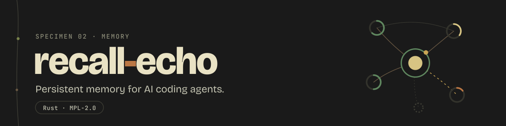

<p align="center">
  
</p>

<p align="center">
  <a href="https://crates.io/crates/recall-echo"></a>
  <a href="https://github.com/dnacenta/recall-echo/actions/workflows/ci.yml"></a>
  
  <a href="LICENSE"></a>
</p>

<p align="center">
  Memory for your coding agent: every session kept, turned into a knowledge graph,
  and there to ask the next time it matters.
</p>

recall-echo captures your agent's sessions as they end, turns them into a knowledge graph
while the machine is idle, and gives every claim a confidence that rises with corroboration
and falls with contradiction. Your agent asks it questions over MCP. The database and the
embeddings run locally; only extraction calls a model, and that can be the CLI subscription
you already pay for.

## Install

```sh
curl -fsSL https://raw.githubusercontent.com/dnacenta/recall-echo/main/install.sh | sh
recall-echo init
```

`init` finds your agent CLIs (Claude Code, Codex, Grok, Gemini), installs the hooks and
the rules file that loads MEMORY.md into every Claude Code session, registers the MCP
server with each and downloads the embedding model. With cargo:
`cargo install recall-echo --locked`. Prebuilt binaries are on the
[releases page](https://github.com/dnacenta/recall-echo/releases/latest).

## Using it

Day to day you do nothing. To look, or to fix something:

```sh
recall-echo what-do-you-know --about D          # what it believes, and how sure it is
recall-echo graph query "auth flow"             # search by meaning
recall-echo graph correct D USES Vim --wrong    # that claim is mistaken
recall-echo status                              # health
```

Inside the agent, it asks for itself:

> **You:** why did we drop the websocket approach?
> **Agent:** *(calls `recall_query`)* You moved off it in June: the reconnect logic kept
> dropping messages under load, and you settled on polling every 30 seconds.

On a LongMemEval subset it went from 0 of 9 answers right to 7 of 9. A small sample,
stated as one: [benchmarks](docs/benchmarks/).

## Docs

- [How it works](docs/internals.md): the four layers, confidence, provenance, MCP, the daemon
- [Commands](docs/commands.md): every subcommand and flag
- [Configuration](docs/configuration.md): providers and every setting
- [Troubleshooting](docs/troubleshooting.md)

## License

[MPL-2.0](LICENSE). Versions up to v3.13.0 remain available under AGPL-3.0. The graph
store, SurrealDB 3.x, is BSL 1.1: embedding it is allowed, and it becomes Apache-2.0 in 2030.
